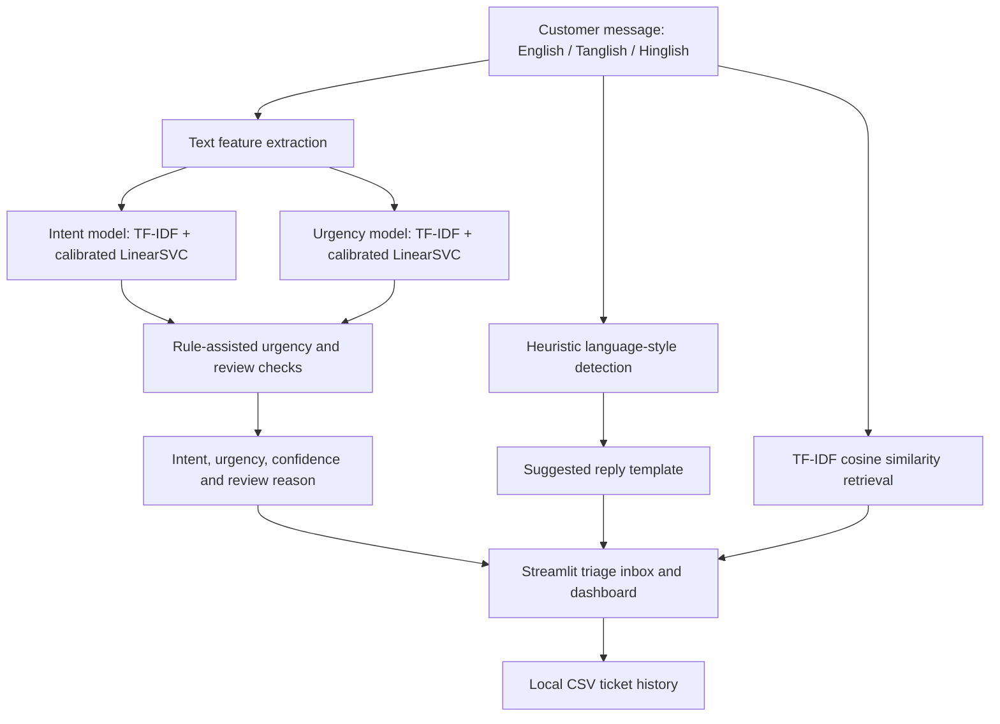

# Code-Mixed Support Triage Assistant

**NEXAI Hack 2026 · Problem Statement 1.1 · Customer Service**

## 1. Problem Statement

Indian customers often contact customer support using English mixed with Tamil written in Latin script (Tanglish) or Hindi written in Latin script (Hinglish). For example:

> "order vandhuchu but box damaged, refund venum"

Manually reading each message, identifying the customer's issue and urgency, drafting a reply, and routing the ticket takes time. This project is a prototype that assists with those triage tasks and flags selected cases for human review.

## 2. Solution Overview

The application accepts a message written in English, Tanglish, or Hinglish and provides:

- **Intent classification** for supported customer-support categories such as refunds, returns, delivery, payments, accounts, and product issues.
- **Urgency estimation** with low, medium, and high labels.
- **Confidence estimates** from calibrated classifier probabilities.
- **Rule-assisted checks** for selected high-risk payment/account signals and unclear delivery timelines.
- **Human-review flags** with an explanatory reason for selected uncertain or high-priority cases.
- **Suggested reply drafts** using prepared English, Tanglish, and Hinglish templates chosen by heuristic language-style detection.
- **Similar-example retrieval** using TF-IDF and cosine similarity.
- **Support dashboard** for reviewing ticket history and intent/urgency patterns.

This is a prototype, not an autonomous helpdesk. Suggested replies should be reviewed before sending. The current code does not call an LLM API; it uses traditional machine learning, explicit rules, and reply templates.

## 3. Architecture



## 4. Technology Stack

| Technology | Purpose |
|---|---|
| Python | Application logic and model training |
| Streamlit | Web application and dashboard UI |
| scikit-learn | TF-IDF features, calibrated LinearSVC classifiers, cosine similarity, and evaluation metrics |
| Pandas and NumPy | Data loading and numerical processing |
| Joblib | Saving/loading trained models and label encoders |
| Plotly | Dashboard charts |
| Python regular expressions (`re`) | Phrase-based triage rules and language-style heuristics |
| CSV | Training examples, held-out evaluation data, and local ticket history |
| Hugging Face `datasets` | Downloading the recommended Bitext dataset |

## 5. Repository Contents

- `app.py` — Streamlit inbox, prediction results, reply suggestions, similar examples, ticket history, and dashboard.
- `train_model.py` — trains the intent and urgency classifiers using word-level and character-level TF-IDF features with calibrated LinearSVC.
- `triage_rules.py` — shared rule-based urgency and ambiguous-delivery review logic.
- `test_model.py` — exercises representative messages through the triage pipeline.
- `evaluate_model.py` — evaluates model outputs against `data/test_cases.csv` and writes per-message predictions to `evaluation_results.csv`.
- `prepare_bitext_data.py` — downloads the Bitext dataset and maps supported intents to the application's intent taxonomy.
- `requirements.txt` — required Python dependencies.
- `Dockerfile.vercel` — experimental deployment configuration; it is not evidence of a verified public deployment.
- `data/support_tickets.csv` — manually labelled project examples.
- `data/codemixed_expanded.csv` — synthetic labelled English/Tanglish/Hinglish examples.
- `data/test_cases.csv` — 30 labelled messages used by the current evaluation script.
- `data/codemixed_test_set.csv` — additional team-written code-mixed cases; note that the current `evaluate_model.py` evaluates `data/test_cases.csv`, not this additional file.
- `data/bitext_mapped.csv` — generated locally by `prepare_bitext_data.py`; not committed to the repository.
- `*.joblib` — four model/label-encoder artifacts generated by `train_model.py`; not committed and must be regenerated locally.

## 6. Setup and Execution (Windows)

Install Python 3, then open PowerShell in the repository root.

```powershell
py -m venv .venv
.\.venv\Scripts\Activate.ps1
python -m pip install --upgrade pip
python -m pip install -r requirements.txt
python train_model.py
python -m streamlit run app.py
```

Open **http://localhost:8501** in your browser.

If PowerShell blocks activation, run the install/train/run commands in a Python environment that already has the dependencies installed:

```powershell
python -m pip install -r requirements.txt
python train_model.py
python -m streamlit run app.py
```

The `.joblib` files are intentionally ignored by Git. Run `python train_model.py` after installing dependencies and before starting `app.py`.

### Optional: Prepare Bitext data

The problem statement recommends the [Bitext Customer Support LLM Chatbot Training Dataset on Hugging Face](https://huggingface.co/datasets/bitext/Bitext-customer-support-llm-chatbot-training-dataset). To download and map the supported intents:

```powershell
python prepare_bitext_data.py
python train_model.py
```

The preparation script writes `data/bitext_mapped.csv`. The training script uses that file only when it exists. The mapping script retains a subset of supported intents, not every original Bitext intent. It also creates heuristic urgency labels because the source dataset does not provide this application's urgency labels. Review the preprocessing for placeholders such as `{{Order Number}}` before treating the mapped data as fully cleaned.

## 7. Evaluation

After training the models, run:

```powershell
python evaluate_model.py
python -m unittest discover -s tests
```

The evaluator reports intent accuracy, ML-only urgency accuracy, rule-assisted urgency accuracy, classification reports, and incorrect examples. Detailed per-message predictions are written to the local file `evaluation_results.csv`.

### Evaluation Results

The repository includes an evaluator, but no verified metric values are published in this README. Run `python evaluate_model.py` locally and record the results from that run before presenting any accuracy or macro-F1 figures.

The urgency labels include heuristics and the rules were iterated during development, so rule-assisted results may be optimistic. The 30-row evaluation set covers delivery, refund, payment, and account-support examples rather than every intent category. Inspect per-class results and mistakes; do not change evaluation labels just to increase a score. Evaluate a fresh, independently labelled test set for a less biased estimate.

## 8. Dataset Attribution and Licence

**Bitext Customer Support Dataset**

- Dataset: [bitext/Bitext-customer-support-llm-chatbot-training-dataset](https://huggingface.co/datasets/bitext/Bitext-customer-support-llm-chatbot-training-dataset)
- Publisher: Bitext.
- Licence listed on the dataset card: **CDLA-Sharing-1.0**. Read the [dataset card](https://huggingface.co/datasets/bitext/Bitext-customer-support-llm-chatbot-training-dataset) and comply with its terms before redistributing source data.
- The source dataset contains synthetic English customer-support request/response pairs and intent labels. It is not a Tanglish/Hinglish dataset.
- This project maps a subset of source intents to a smaller taxonomy. The generated urgency values are weak heuristic labels, not human-provided ground truth.

The manually written examples in `support_tickets.csv`, `codemixed_expanded.csv`, and the held-out test files are separate project data. Keep training examples separate from evaluation messages and any similarity/few-shot example bank.

## 9. Deployment URL / Approved Local Demo

**Local demo:** Run the commands in [Setup and Execution](#6-setup-and-execution-windows), then open **http://localhost:8501**.

A public deployment URL is not listed because a successful end-to-end cloud deployment of the Python Streamlit application has not yet been verified. `Dockerfile.vercel` is experimental configuration only; do not treat it as a live URL or a confirmed deployment.

## 10. Team Members

| Team member | Details |
|---|---|
| Pragadeesh Kumar | Project owner / maintainer — [GitHub profile](https://github.com/pragadeesh448-lab) |

Add the actual names, identifiers (if required by the event), and responsibilities of any additional teammates before final submission. Do not leave unverified placeholders in the submitted README.

## 11. Limitations and Responsible Use

- Bitext is synthetic English data and does not represent every real-world Indian code-mixed message.
- The supported-intent mapping is a subset of the original dataset; urgency labels generated by the preparation script are heuristic.
- Review preprocessing for dataset placeholders before relying on mapped examples.
- Calibrated classifier scores are estimates, not guarantees of correctness; they do not automatically validate a rule override.
- Language-style detection is heuristic and may select the wrong reply style for mixed messages.
- Human-review flags are decision-support signals, not a guarantee that every incorrect prediction will be escalated.
- Replies are drafts and must be checked by a person before being sent.
- Ticket history is saved to local CSV storage; persistent multi-user storage and integration with a real customer-support platform are not implemented.

## Development Log

A separate `DEV_LOG.md` is not currently maintained. See the [GitHub commit history](https://github.com/pragadeesh448-lab/CodeMixedSupportTriage/commits/master) for recorded code changes.
