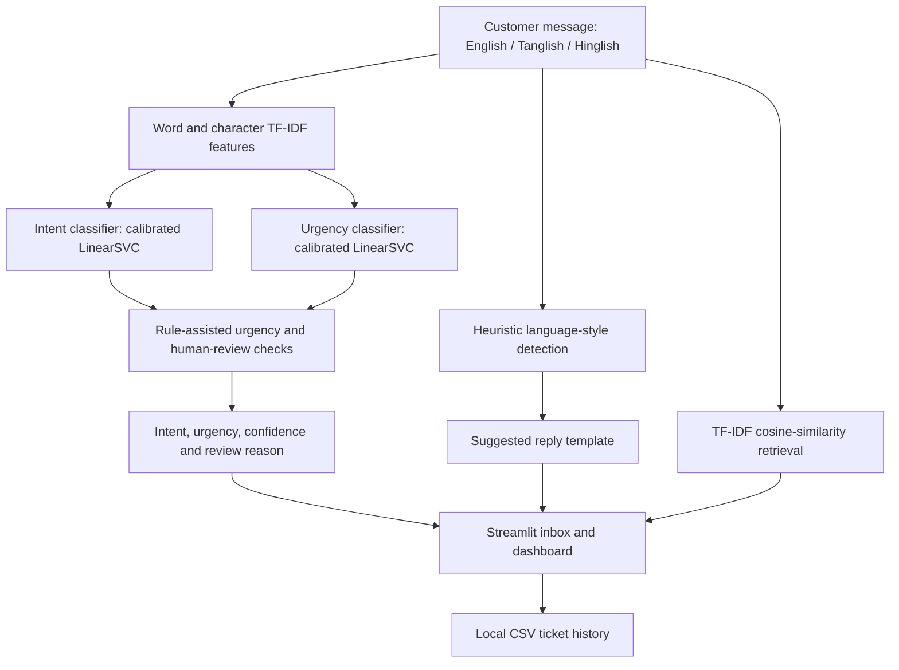

# Code-Mixed Support Triage Assistant

**NEXAI Hack 2026 · Problem Statement 1.1 · Track 1: Customer Service**

**Team ID: 31**

## 1. Problem Statement

Indian customers often contact support in messages that mix English with Tamil written in Latin script (Tanglish) or Hindi written in Latin script (Hinglish). For example:

> "order vandhuchu but box damaged, refund venum"

Support teams can spend time manually reading each message, identifying the issue and urgency, preparing a reply, and deciding which team should handle it.

## 2. Solution Overview

The Code-Mixed Support Triage Assistant is a Python and Streamlit prototype that helps a support team review incoming English, Tanglish, and Hinglish messages. It provides:

- **Intent classification** for supported support categories such as refund, return, delivery, payment, account, and product issues.
- **Urgency estimation** using low, medium, or high labels.
- **Confidence estimates** from calibrated classifier probabilities.
- **Rule-assisted checks** for selected high-risk payment/account signals and unclear delivery timelines.
- **Human-review flags** with a reason for selected uncertain or high-priority cases.
- **Suggested reply drafts** using prepared English, Tanglish, and Hinglish templates selected with heuristic language-style detection.
- **Similar-example retrieval** using TF-IDF and cosine similarity.
- **A ticket dashboard** for reviewing ticket history and intent/urgency patterns.

This is a decision-support prototype, not an autonomous helpdesk. A support agent should review any suggested reply before sending it. The current implementation does **not** call an LLM API; it uses traditional machine learning, explicit rules, and reply templates.

## 3. Architecture



## 4. Technology Stack

| Technology | How it is used |
|---|---|
| Python | Application logic and model training |
| Streamlit | Web interface, inbox and dashboard |
| scikit-learn | TF-IDF vectorization, calibrated LinearSVC classifiers, cosine similarity, and evaluation metrics |
| Pandas / NumPy | Dataset loading and numerical processing |
| Joblib | Saving and loading trained models and label encoders |
| Plotly | Interactive dashboard charts |
| Python `re` module | Pattern-based triage rules and language-style heuristics |
| CSV | Training examples, evaluation cases, and local ticket history |
| Hugging Face `datasets` | Downloading the Bitext source dataset |

## 5. Repository Contents

- `app.py` — Streamlit triage inbox, prediction results, suggested replies, similar examples, ticket history, and dashboard.
- `train_model.py` — trains intent and urgency classifiers using word-level and character-level TF-IDF features with calibrated LinearSVC models.
- `triage_rules.py` — shared rule-based urgency and ambiguous-delivery review logic.
- `test_model.py` — runs representative messages through the triage pipeline.
- `evaluate_model.py` — evaluates predictions against `data/test_cases.csv` and writes detailed predictions to `evaluation_results.csv`.
- `prepare_bitext_data.py` — downloads the Bitext dataset and maps selected source intents to this application's intent taxonomy.
- `requirements.txt` — Python dependencies.
- `Dockerfile.vercel` — experimental container configuration for deployment exploration.
- `data/support_tickets.csv` — manually labelled project examples.
- `data/codemixed_expanded.csv` — synthetic, labelled English/Tanglish/Hinglish examples.
- `data/test_cases.csv` — 30 labelled messages used by the current evaluation script.
- `data/codemixed_test_set.csv` — additional team-written code-mixed examples; the current `evaluate_model.py` script evaluates `data/test_cases.csv`, not this additional file.
- `data/bitext_mapped.csv` — generated locally by `prepare_bitext_data.py`; it is not committed to the repository.
- `*.joblib` — four trained model/label-encoder artifacts generated by `train_model.py`; they are not committed and must be created before starting the app.

## 6. Setup and Execution (Windows)

Install Python 3.10+ and open PowerShell in the repository root.

```powershell
py -m venv .venv
.\.venv\Scripts\Activate.ps1
python -m pip install --upgrade pip
python -m pip install -r requirements.txt
python train_model.py
python -m streamlit run app.py
```

Open **http://localhost:8501** in your browser.

If PowerShell blocks virtual-environment activation, use a terminal where the required Python dependencies are installed:

```powershell
python -m pip install -r requirements.txt
python train_model.py
python -m streamlit run app.py
```

The trained `.joblib` artifacts are excluded from Git. Run `python train_model.py` after installing dependencies and before starting the app.

### Optional: Prepare the Bitext Dataset

The problem statement recommends the [Bitext Customer Support LLM Chatbot Training Dataset on Hugging Face](https://huggingface.co/datasets/bitext/Bitext-customer-support-llm-chatbot-training-dataset). To download and map supported intents locally:

```powershell
python prepare_bitext_data.py
python train_model.py
```

The script writes `data/bitext_mapped.csv`, and the training script uses it if the file exists. The mapping retains a subset of supported source intents rather than every original Bitext intent. The source does not include this application's urgency labels, so the preparation script assigns heuristic urgency labels. Review preprocessing of placeholders such as `{{Order Number}}` before describing the mapped data as fully cleaned.

## 7. Evaluation

Run evaluation after generating the model artifacts:

```powershell
python evaluate_model.py
python -m unittest discover -s tests
```

The evaluator reports intent accuracy, ML-only urgency accuracy, rule-assisted urgency accuracy, classification reports, and incorrect examples. Per-message predictions are saved locally to `evaluation_results.csv`.

### Results to Report

**Evaluation figures are intentionally not listed here yet.** Please run the evaluator on the current code and share the output before adding numerical results. Do not reuse an old result or change held-out labels just to improve a score.

The current 30-row hold-out set covers delivery, refund, payment, and account-support examples rather than every intent category. Urgency labels created from Bitext are heuristic, and rules were iterated during development; therefore, rule-assisted results can be optimistic. Inspect per-class reports and incorrect examples, and use a fresh independently labelled test set for a less biased estimate.

## 8. Dataset Attribution and Licence

**Bitext Customer Support Dataset**

- **Dataset:** [bitext/Bitext-customer-support-llm-chatbot-training-dataset](https://huggingface.co/datasets/bitext/Bitext-customer-support-llm-chatbot-training-dataset)
- **Publisher:** Bitext.
- **Licence stated on the dataset card:** **CDLA-Sharing-1.0**. Review the [dataset card and licence terms](https://huggingface.co/datasets/bitext/Bitext-customer-support-llm-chatbot-training-dataset) before redistributing source data.
- **Source language:** English. The source dataset does not itself provide Tanglish/Hinglish examples.
- **Use in this project:** `prepare_bitext_data.py` maps a subset of supported source intents into the application's smaller taxonomy. Its generated urgency labels are heuristic rather than human-provided ground truth.

The manually written project examples and labelled evaluation cases are separate from the Bitext source data. Keep evaluation messages separate from training examples and the similarity-example bank.

## 9. Live Deployment / Local Demo

**Live application URL (provided by the team):** [https://codemixedsupporttriage.onrender.com/](https://codemixedsupporttriage.onrender.com/)

If the hosted service is unavailable, run the app locally using [Setup and Execution](#6-setup-and-execution-windows) and open **http://localhost:8501**.

## 10. Team Details

**Team ID: 31**

| Team member | Registration ID |
|---|---|
| Mohamed Ziyaullah S | 24MID0265 |
| Pragadeesh K | 24MID0317 |
| Shiyam R | 24MID0315 |
| Sudarshana MM | 24MID0101 |

## 11. Limitations and Responsible Use

- The Bitext source is synthetic English data and does not represent every real-world Indian code-mixed message.
- The Bitext preparation script maps only selected source intents, and its urgency labels are heuristic.
- Placeholder cleanup in the source data should be checked before treating it as fully preprocessed.
- Calibrated classifier scores are estimates, not guarantees of correctness. A rule-based override is not itself a calibrated probability.
- Language-style detection is heuristic and can choose the wrong reply style for mixed messages.
- Human-review flags are decision-support signals; they do not guarantee that every incorrect prediction is escalated.
- Suggested replies are drafts and must be reviewed by a person before sending.
- Ticket history is stored in a local CSV file. Persistent multi-user storage and integration with an external helpdesk are not implemented.

## Development Log

The team maintains a `DEV_LOG.md`. **Note:** `DEV_LOG.md` was not present in the inspected GitHub `master` branch when this README was updated. Commit that file to the repository so this link resolves before final submission: [DEV_LOG.md](DEV_LOG.md).

For committed code changes, see the [GitHub commit history](https://github.com/pragadeesh448-lab/CodeMixedSupportTriage/commits/master).
